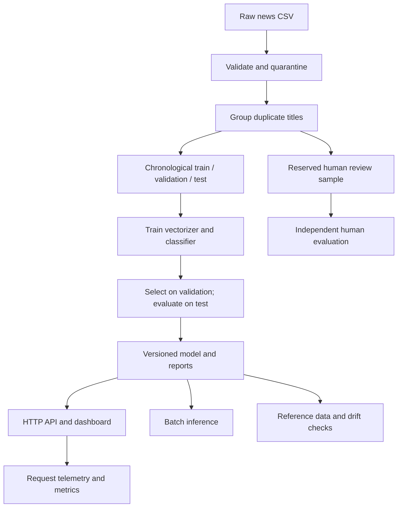

# News Signal — end-to-end financial news sentiment MLOps

A separate capstone project built for Tushar Pal. Trains a CPU text classifier from the supplied news CSV, serves real-time and batch inference, provides a browser dashboard, monitoring and drift reports, model explanations, versioned artifacts, tests, CI/CD and container infrastructure.

**Scope:** article/snippet sentiment (positive, neutral, negative). Company extraction, company-specific sentiment and event/EWS classification are not implemented because their labels are absent. Supplied sentiment labels are automated; reported scores measure agreement with those labels, not validated investment insight.

## Start here — Windows PowerShell

Install Python 3.12 (64-bit). Extract this ZIP, open PowerShell in the project directory. A copy of your supplied dataset and a trained run are included for your private use.

```powershell
py -3.12 -m venv .venv
.\.venv\Scripts\python.exe -m pip install -r requirements.txt
# Rebuild and verify the complete workflow (training included):
.\.venv\Scripts\python.exe golden_path.py
# Start the API and dashboard; keep this terminal open:
.\.venv\Scripts\python.exe -m newsml.server
```

Open http://127.0.0.1:8000 . Ctrl+C stops the service. No API keys, LLM service, AWS resources or GPU are needed. Internet is needed for initial package installation; the pipeline runs offline afterward. The dashboard is embedded in the API application; it is not a separately hosted website.

Linux/macOS equivalent:

```bash
python3.12 -m venv .venv
.venv/bin/python -m pip install -r requirements.txt
.venv/bin/python golden_path.py
.venv/bin/python -m newsml.server
```

To use the included model without retraining, install the exact requirements and run the server. Models serialized with joblib should only be loaded from trusted sources and matching dependency versions.

## Run all local steps with one command

After installing Python 3.12, Docker Desktop and Node.js, open PowerShell in the project folder and run:

```powershell
.\scripts\run_all.ps1 -WithDocker -WithBrowserTests
```

This installs the pinned Python requirements, runs the complete training/evaluation/test pipeline, executes real browser interaction tests, builds and starts Docker services and Prometheus, and checks service health. It fails at the failing step rather than claiming success. Docker Desktop must already be running. Without the two switches, it runs the Python pipeline and starts the local dashboard. If your machine's PowerShell policy prevents scripts, use the individual commands below; no policy changes are made by the project.

The script and added CI browser job are provided but not executed in this restricted environment. Browser tests use synthetic fixtures for UI behavior; actual dataset evaluation remains in the saved run.

## Individual commands

```powershell
# Offline preparation, training, selection, evaluation and reports
.\.venv\Scripts\python.exe -m newsml.pipeline --input data/raw/news_sentiment_raw.csv
# Tests (isolated synthetic fixtures; no quality claims from fixture performance)
.\.venv\Scripts\python.exe -m unittest discover -s tests -v
# Batch inference on a CSV containing title and optional description
.\.venv\Scripts\python.exe -m newsml.batch --input examples/batch_news.csv --output artifacts/my_predictions.csv
# Drift on a new window of at least 20 records, compared with saved training reference
.\.venv\Scripts\python.exe -m newsml.monitor --input data/raw/news_sentiment_raw.csv --output artifacts/latest_drift.json
```

The final drift command is a syntax example; comparing the raw corpus to its training subset is not a genuine new production window. For meaningful monitoring, supply a later, unseen batch. The dashboard displays the immutable run's test drift and simulation reports, not arbitrary CLI output paths.

Live request in a SECOND PowerShell terminal:

```powershell
$news = @{ title = 'Company reports a quarterly loss'; description = 'Revenue declined while operating costs increased.' } | ConvertTo-Json
Invoke-RestMethod -Method Post -Uri http://127.0.0.1:8000/predict -ContentType 'application/json' -Body $news
Invoke-RestMethod -Uri http://127.0.0.1:8000/health
Invoke-RestMethod -Method Post -Uri http://127.0.0.1:8000/batch -ContentType 'text/csv' -InFile examples/batch_news.csv
```

## Architecture



Only headline + description enter the model. compound, pos, neg, neu, source_weight, topic, source and dates are not model inputs. Fit vocabulary on training data only. Validation chooses regularization from two candidates; test is not used for tuning. Training and inference share the same serialized sklearn Pipeline.

## Outputs and provenance

`artifacts/current.json` points to the latest completed run. Each timestamped run contains:

- `model.joblib`: complete fitted vectorizer and classifier.
- `manifest.json`: input/model hashes, run ID, package versions and Git commit if available.
- `execution.jsonl`: actual stage logs.
- `data_quality.json`, `rejected.csv`, `duplicates.csv`, `train.csv`, `validation.csv`, `test.csv`.
- `metrics.json`, `test_predictions.csv`, `responsible_ai.json`.
- `reference.csv`, `drift.json`, `drift_simulation.json` (explicit synthetic demonstration).
- `human_review_template.csv`, `reserved_review_ids.json`.
- Golden-path runs additionally contain `batch_predictions.csv`, `golden_path.json`, `smoke_logs/`.

Reruns create new directories; they do not overwrite prior models. Only a successful full pipeline updates the pointer. The running API loads its model once: restart after promotion. Rollback: stop service, restore a previous current.json containing that run ID and matching model hash, restart, verify /health. Keep the previous pointer before promotion. No automatic retraining or unattended model promotion from drift alerts.

## API

| Endpoint | Method | Behavior |
|---|---|---|
| `/` | GET | Dashboard |
| `/health` | GET | Ready status and loaded model version |
| `/predict` | POST JSON | title required, description optional; sentiment/probabilities/explanation |
| `/batch` | POST text/csv | Up to 500 rows, returns JSON predictions in input order |
| `/monitoring` | GET | Current-process request/error/latency totals |
| `/metrics` | GET | Prometheus-compatible metrics |
| `/report/metrics`, `/report/quality` | GET | Evaluation and validation |
| `/report/drift`, `/report/drift-simulation` | GET | Real test-window and simulated drift reports |
| `/report/responsible-ai`, `/report/manifest` | GET | Explanations/error slices and provenance |

HTTP body limit: 2 MB. Headline limit: 2,000 characters; description: 20,000. CLI batch chunks arbitrary-size CSVs into groups of 500. Invalid rows fail the batch with an error; they are not silently dropped. Request logs exclude raw text. The standard-library threaded server is deliberately a local/private capstone server, not an internet-hardened gateway.

## Human-reviewed evaluation

Review the reserved template from the active run, fill human_label (negative/neutral/positive), reviewer, rationale and save a separate CSV. Leave text and group IDs unchanged. Do not label from the original score. See docs/MODEL_CARD.md for policy and limitations.

```powershell
.\.venv\Scripts\python.exe -m newsml.evaluate_review --input data/reviewed/completed_review.csv --output artifacts/human_evaluation.json
```

This rejects empty labels and any records outside the reserved set. Human review has NOT been performed by this project. An LLM-generated annotation would not count as human verification. Evaluation on that sample must remain separate from weak-label test metrics.

## Docker infrastructure

Install Docker with Compose v2. From this directory:

```bash
docker compose build
docker compose run --rm train
docker compose up -d --wait app
docker compose ps
# Optional Prometheus monitoring, open localhost:9090
docker compose --profile monitoring up -d prometheus
# Stop while retaining named model/log volumes
docker compose down
```

Training reads the dataset from a read-only bind mount and writes a named model volume. The app mounts that volume read-only and stores request logs in a separate volume. Published ports bind only to localhost. Optional Prometheus includes service-down and error-rate rules; no external notification receiver is configured. Docker was not available in the build environment, so these commands still require execution on your machine.

For a remote private Linux host use Docker, copy project + authorized dataset, execute these commands and access via an SSH tunnel (`ssh -L 8000:127.0.0.1:8000 user@host`). Do not expose this demonstration HTTP service directly to the public internet. Public hosting needs authentication, TLS proxy, rate limits, load tests and an appropriate production server.

## CI/CD and public repository

`.github/workflows/ci.yml` runs unit/integration tests, builds the Docker image, then tests inside it. It uses synthetic test fixtures, not the private dataset. `.github/workflows/deploy.yml` is manually dispatched to a dedicated private Linux self-hosted runner tagged `news-capstone`, in environment `capstone-private`. Provision Docker/Compose and `/opt/news-capstone/data/news_sentiment_raw.csv` first. Add environment approval protection. Do not use a self-hosted runner for untrusted pull requests.

Initialize a repo, commit source/docs/tests, connect your GitHub remote, and push. The existing .gitignore excludes raw data, trained artifacts, logs and secrets. Run the CI workflow, then provision/configure the runner and manually dispatch deployment. Its health check and Compose status provide deployment evidence. GitHub workflows are provided, but have not run in your account.

The assignment requires a public repository. The dataset's upstream Kaggle URL and license were not supplied: add them in data/DATASET.md and confirm rights before publishing text or generated data-bearing artifacts. Hash and local placement instructions are included. Downloading raw data is intentionally not automated from an unknown source. This private ZIP includes your supplied CSV; it should not be uploaded wholesale as a public release.

## Assignment and demonstration

- docs/REQUIREMENTS_MATRIX.md: phase-by-phase mapping and remaining evidence.
- docs/MODEL_CARD.md: label provenance, evaluation, explainability, limitations.
- docs/DEMO_SCRIPT.md: 11-minute screen-recording plan.
- docs/VERIFICATION.md: actual results and tested/untested boundaries.

The submitted video must show your real desktop, voice, webcam identity verification, name/BITS ID, repository commit and functional evidence, within 10–12 minutes. This package cannot substitute configuration files for a successful hosted workflow or record your identity verification.
