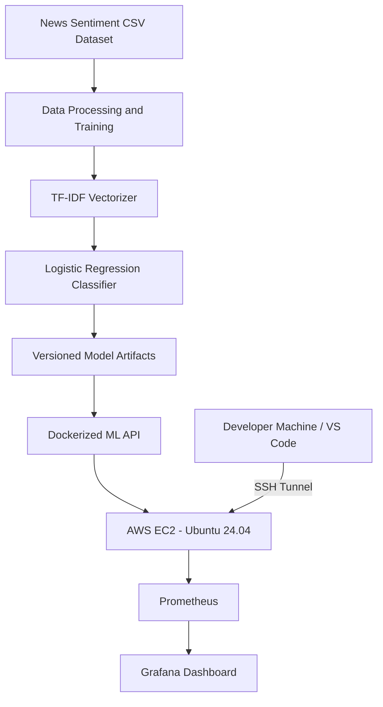

# News Sentiment Classification — MLOps Capstone

A machine learning application that classifies the sentiment of financial news headlines. The project includes a training pipeline, a REST API, Docker-based deployment on AWS EC2, and monitoring with Prometheus and Grafana.

## 1. Architecture



### AWS deployment architecture

- **AWS EC2:** Ubuntu 24.04 LTS instance in the `eu-north-1` region.
- **EBS storage:** Expanded root volume of 20 GiB.
- **Docker Engine and Docker Compose:** Used to build and run the application services.
- **ML API:** Serves predictions using TF-IDF and Logistic Regression.
- **Model artifacts:** Stored in a Docker named volume.
- **Prometheus:** Scrapes application metrics from the API.
- **Grafana:** Displays operational metrics using Prometheus as its data source.
- **SSH tunneling:** Allows local access to the API and monitoring dashboards without exposing their ports directly to the public internet.

## 2. Technology Stack

- Python
- Pandas and NumPy
- Scikit-learn
- TF-IDF and Logistic Regression
- Docker and Docker Compose
- AWS EC2 and EBS
- Prometheus
- Grafana
- Git and GitHub

## 3. Dataset and Model

The raw dataset is stored at:

`data/raw/news_sentiment_raw.csv`

The dataset contains news metadata, headlines, descriptions, sources, topics, and sentiment labels.

### Recorded evaluation results

| Metric | Result |
|---|---:|
| Test accuracy | 71.38% |
| Test macro F1 | 0.6096 |
| Model version | `20261024T112614Z-f201c4` |

These metrics are from the recorded training run and may vary after retraining.

## 4. Running the Application

Run these commands from the repository root.

### Build the Docker image

```bash
docker compose build
```

### Start the application API

```bash
docker compose up -d --wait app
```

### Start Prometheus and Grafana

```bash
docker compose -f compose.yaml -f compose.grafana.yaml --profile monitoring up -d --wait prometheus grafana
```

### Check running services

```bash
docker compose -f compose.yaml -f compose.grafana.yaml --profile monitoring ps
```

### Inspect application logs

```bash
docker compose logs --tail=100 app
```

## 5. API Endpoints

| Method | Endpoint | Purpose |
|---|---|---|
| GET | `/health` | Check application readiness and model version |
| GET | `/monitoring` | View application monitoring summary |
| GET | `/metrics` | Expose Prometheus metrics |
| GET | `/report/metrics` | Metrics report |
| GET | `/report/quality` | Model quality report |
| GET | `/report/drift` | Data drift report |
| GET | `/report/drift-simulation` | Drift simulation report |
| GET | `/report/responsible-ai` | Responsible AI report |
| GET | `/report/manifest` | Model manifest |
| POST | `/predict` | Predict sentiment for one headline |
| POST | `/batch` | Batch predictions |
| POST | `/evaluate` | Evaluate supplied data |
| POST | `/drift` | Analyze drift |

### Health check

```bash
curl http://127.0.0.1:18002/health
```

### Example prediction

```bash
curl -X POST http://127.0.0.1:18002/predict \
  -H "Content-Type: application/json" \
  -d '{"title":"The company reported excellent earnings and strong revenue growth."}'
```

The prediction request must use the `title` field.

## 6. Monitoring

### Prometheus

Prometheus collects metrics from the ML API's `/metrics` endpoint.

Dashboard URL when accessed through the SSH tunnel:

`http://127.0.0.1:19090`

Confirm that the application scrape target is **UP**.

### Grafana

Grafana visualizes service metrics collected by Prometheus.

Dashboard URL:

`http://127.0.0.1:13000/d/news-sentiment-ops`

Grafana home:

`http://127.0.0.1:13000`

## 7. SSH Access from Windows / VS Code

Run this command in the VS Code PowerShell terminal:

```powershell
ssh -i "C:\Users\paltu\news-sentiment-mlops\env-key.pem" -L 13000:127.0.0.1:3000 -L 18002:127.0.0.1:8002 -L 19090:127.0.0.1:9090 ubuntu@56.228.42.35
```

Keep the terminal open while accessing the services.

| Service | Local URL |
|---|---|
| ML API health | http://127.0.0.1:18002/health |
| Grafana | http://127.0.0.1:13000 |
| Grafana dashboard | http://127.0.0.1:13000/d/news-sentiment-ops |
| Prometheus | http://127.0.0.1:19090 |

### Security considerations

- Never commit private SSH keys or credentials to GitHub.
- Keep the application and monitoring ports bound to localhost unless a secure access layer has been configured.
- Restrict the EC2 security group to the required SSH access.
- Change default Grafana credentials if they have not already been changed.

## 8. Responsible AI and Limitations

- This model classifies news sentiment; it does not predict stock prices.
- The recorded test accuracy is approximately 71.38%, so predictions can be incorrect.
- Confidence scores should not be treated as calibrated probabilities without further validation.
- Automated or weakly generated sentiment labels may contain noise.
- Financial decisions should not rely solely on the model's output.

## 9. Future Improvements

- Improve classification performance and evaluate per-class precision and recall.
- Validate sentiment labels using a human-reviewed sample.
- Add data and model drift alerts.
- Strengthen automated tests and CI/CD.
- Introduce model version tracking and reproducible training.
- Add authentication, TLS, and production-grade secret management if externally exposed.

## 10. Repository

GitHub: https://github.com/Tushar01-repo/bits-capstone-project
